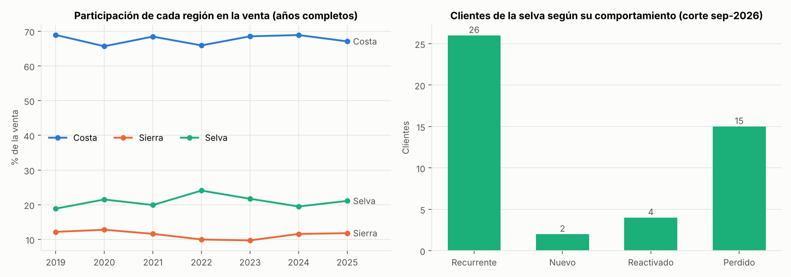
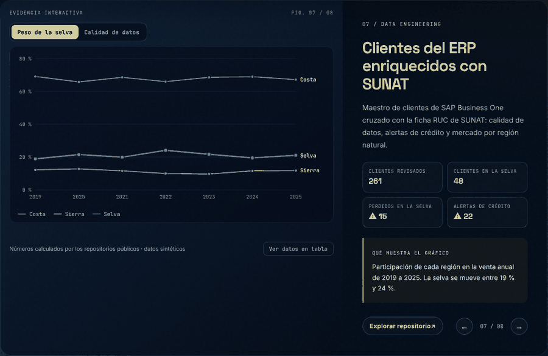
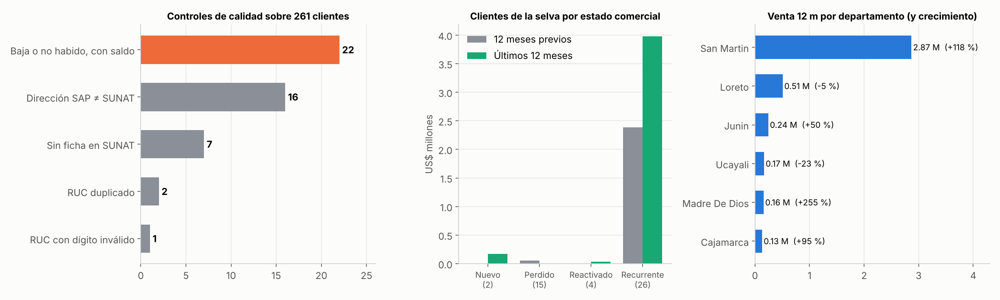
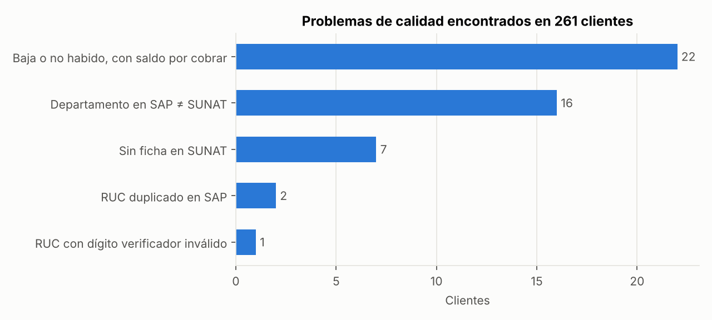

# Enriquecimiento de clientes con SUNAT · Calidad de datos y mercado por región

> **EN —** A customer-master enrichment pipeline for a Peruvian B2B company. It extracts customers and addresses from **SAP Business One** with a parametrized read-only SQL query, enriches each tax ID (RUC) with the public **SUNAT** registry record, and flags data-quality and credit issues. It then sizes the market by natural region, focusing on the Amazon (*selva*). Lookups are resumable: progress is saved after every query. **Every company, RUC and sale in this repo is synthetic.**



## Demo y capturas



> El mismo gráfico es **interactivo** en el [laboratorio de mi portafolio](https://dataross.vercel.app/#laboratorio): mueve los controles y se redibuja con los resultados de este repositorio.



*Alertas de calidad, estado comercial y departamentos de la selva.*

## El problema

El maestro de clientes del ERP envejece: direcciones que ya no corresponden, RUC mal digitados o duplicados,
clientes que SUNAT dio de baja y que todavía tienen saldo. Además, la pregunta comercial
**"¿cuánto pesa la selva y cómo está evolucionando?"** no se puede responder si la ubicación del cliente
no es confiable.

## El flujo

```
SAP Business One (HANA) ── consulta SQL de solo lectura ──► maestro de clientes + direcciones
        │                                                          │
        │                                     una fila por cliente (dirección fiscal predeterminada)
        ▼                                                          ▼
 Ficha RUC de SUNAT ── parser de texto ──► estado, condición, domicilio, CIIU, comercio exterior
        │               (avance guardado tras CADA consulta; se puede cortar y retomar)
        ▼
 Enriquecimiento ──► calidad de datos · alertas de crédito · región natural · rubro por CIIU
        ▼
 Mercado por región ──► participación por año · clientes nuevos / recurrentes / reactivados / perdidos
```

| Componente | Qué hace |
|---|---|
| `sql/maestro_clientes_sap_b1.sql` | Consulta sobre las tablas estándar de SAP B1 (OCRD, CRD1, OSLP, OCRG, OCST, OCRY). Arma la dirección completa y marca la predeterminada |
| `sap.py` | Inyecta el esquema desde una variable de entorno (validado contra inyección SQL). Credenciales solo por variables de entorno, nunca en el código ni en rutas de archivos |
| `sunat_parser.py` | Convierte el texto de la ficha RUC en columnas: razón social, estado, condición, domicilio (departamento, provincia, distrito), CIIU principal y secundarios, importador |
| `sunat_scraper.py` | Consulta por lotes: guarda el avance después de cada RUC, reintenta los errores en la siguiente corrida y no repite lo que ya salió bien. El captcha lo resuelve una persona |
| `rubros.py` | Validación del RUC (dígito verificador módulo 11), rubro por división CIIU Rev. 4 y región natural (incluye provincias de selva alta) |
| `analisis.py` | Calidad de datos, alertas de crédito, estado comercial de cada cliente y mercado por región |

**La consulta de SAP se prueba de verdad:** las pruebas crean en DuckDB las mismas tablas de SAP B1 y ejecutan
el mismo SQL que se usaría en producción.

## Resultados (datos sintéticos, 261 clientes)



| Control | Clientes |
|---|---|
| **Baja o "no habido" en SUNAT y con saldo por cobrar** | **22**, unos US$ 263 mil de saldo. Alerta directa para crédito y cobranzas |
| Departamento en SAP distinto al de SUNAT | 16. La dirección del ERP está desactualizada |
| Sin ficha en SUNAT | 7 |
| RUC duplicado en SAP (un RUC con dos códigos) | 2 |
| RUC con dígito verificador inválido | 1 |

**Selva:**
- Representa entre 19 % y 24 % de la venta en cada año completo (2019–2025). 48 clientes están ubicados ahí, y 20 son importadores directos.
- **San Martín** duplicó su venta en los últimos 12 meses (+118 %). Pero **un solo cliente explica el 96 %** de esa venta: no es una tendencia del mercado, es un riesgo de concentración.
- De los clientes de la selva, 26 son recurrentes, 2 nuevos, 4 reactivados y **15 se perdieron**: ya no compran en los últimos 12 meses. Esa es una lista concreta para el área comercial.

## Cómo ejecutarlo

**Con doble clic (Windows):** `EJECUTAR_DEMO.bat`.

**Desde la terminal:**

```bash
pip install -r requirements.txt
python run.py      # genera datos sintéticos, corre SAP (en DuckDB), SUNAT (fichas de ejemplo) y el análisis
pytest -q          # 13 pruebas: parser, RUC, CIIU, regiones, SQL de SAP, reanudación del scraper, estados
```

**Con sistemas reales:** define `SAP_HOST`, `SAP_PORT`, `SAP_USER`, `SAP_PASSWORD` y `SAP_SCHEMA` (usuario de solo
lectura), e instala `hdbcli`. Para las fichas, instala `selenium` y usa `SunatWeb().fetch` como función de consulta.
Para estado, condición y ubicación de miles de RUC conviene usar primero el padrón masivo que publica SUNAT y dejar
la consulta individual solo para lo que el padrón no trae (actividad económica, comercio exterior).

## Salidas (`reports/`)

`clientes_enriquecidos.csv` (una fila por cliente, con todas las marcas de calidad y alerta),
`calidad_de_datos.csv`, `mercado_por_region.csv` y `selva_por_*.csv` (por estado comercial, departamento y rubro).

## Siguiente paso

Cruzar los clientes de la selva con las partidas arancelarias que importan, para estimar el mercado que hoy
compra directamente en el exterior.

---
**Rosy Napuchi** · Business Intelligence & Data Science · [Portafolio](https://dataross.vercel.app/)
